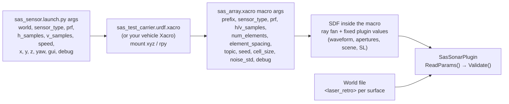
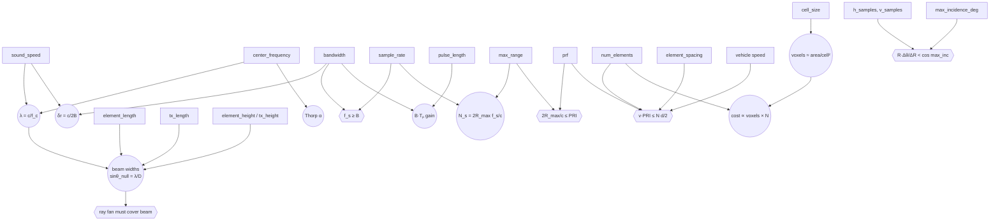
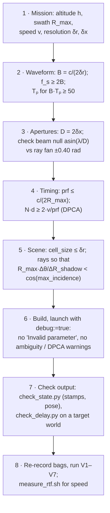

# SAS Parameter-Tuning Guide

How to tune the SAS sensor plugin: every parameter, its default, units, sensible range,
dependencies, effects, and a procedure for changing it safely. Values and equations match the
implementation at release `v0.1.0`; see `SAS_Sensor_Implementation_Study.md` for how the sensor
works.

Conventions used below:

- **Default** = value in `sas_array.xacro` (or the code default when the Xacro does not set it).
- **Tested** = values that were exercised by unit tests, validation (V1–V7), or profiling.
  Ranges outside "tested" are derived from the equations; verify them with the procedure in §9.
- c = `sound_speed`, f_c = `center_frequency`, B = `bandwidth`, Tₚ = `pulse_length`,
  f_s = `sample_rate`, N = `num_elements`, d = `element_spacing`, D = aperture length,
  PRI = 1/`prf`, λ = c/f_c.

---

## 1. Where parameters live



| Layer | How to change |
|-------|---------------|
| Launch args | `ros2 launch sas_bringup sas_sensor.launch.py prf:=5.0 h_samples:=256` |
| Macro args | in your vehicle Xacro: `<xacro:sas_array ... num_elements="32" cell_size="0.08"/>` |
| Fixed SDF values | edit `src/sas_description/urdf/sas_array.xacro`, or add a macro arg for them |
| Surface reflectivity | `<laser_retro>` on both `<visual>` and `<collision>` in the world |

Rebuild after editing installed files (`colcon build --symlink-install`), otherwise the old copy in
`install/` is used.

The plugin rejects invalid combinations at load (`dsp::Validate`) and disables itself with one
error line per problem:

| Rule | Error text |
|------|-----------|
| c > 0, f_c > 0, B > 0, Tₚ > 0 | `... must be > 0` |
| B < 2·f_c | `bandwidth must be < 2 * center_frequency` |
| f_s ≥ B | `sample_rate must be >= bandwidth (complex baseband)` |
| 0 ≤ min_range < max_range | `max_range must be > min_range` |
| N ≥ 1, d > 0, element/tx length > 0 | `... must be >= 1` / `> 0` |
| noise_std ≥ 0, topic not empty | — |

---

## 2. Parameter relationships



Hard constraints (enforced or warned):

| # | Constraint | Default margin | What breaks if violated |
|---|------------|----------------|-------------------------|
| C1 | f_s ≥ B | 40 ≥ 20 kHz | plugin refuses to load |
| C2 | 2·R_max/c ≤ PRI | 0.080 ≤ 0.100 s | warning; echoes beyond c·PRI/2 would fold into the next ping |
| C3 | \|v_along\|·PRI ≤ N·d/2 | 0.15 ≤ 0.32 m (1.5 m/s) | warning; along-track aliasing in the synthetic aperture |
| C4 | ray fan ≥ beam main lobe | ±22.9° vs null ±22.0° | edges of the beam see no scene |
| C5 | R·Δθ/ΔR < cos(max_incidence) | 512 rays | shadows fill in behind objects |
| C6 | `ray max` ≥ `max_range` | 70 ≥ 60 m | far ranges empty |

---

## 3. Waveform parameters

### `sound_speed` — c

| Item | Value |
|------|-------|
| Default | 1500.0 m/s (fixed SDF) |
| Units | m/s |
| Range | 1430–1540 (real sea water); tested: 1500 |
| Dependencies | λ = c/f_c; δr = c/2B; N_s = ⌈2R_max f_s/c⌉; range ambiguity c·PRI/2 |
| Effects | Scales every delay and the wavelength. Lower c → longer delays, more samples, shorter λ (narrower beams). |
| Note | Constant everywhere (no sound-speed profile). Downstream reads it from `SasPing.sound_speed`. |

### `center_frequency` — f_c

| Item | Value |
|------|-------|
| Default | 100 000 Hz (fixed SDF) |
| Units | Hz |
| Range | 50–300 kHz typical for SAS; must satisfy B < 2f_c; tested: 100 kHz |
| Dependencies | λ, beam widths, Thorp α, carrier phase e^{−j2πf_cτ} |
| Effects | Higher f_c → shorter λ → **narrower beams** (sinθ_null = λ/D), shorter synthetic aperture L_sa = λR/D, more absorption (Thorp: ~34 dB/km at 100 kHz, much more above 200 kHz). Along-track resolution D/2 does **not** change. |
| Watch | If the beam narrows a lot you can narrow the ray fan (§6) to save rays. |

Example — beam null versus frequency (D = 0.04 m, c = 1500):

| f_c | λ | first null | −3 dB two-way | α (Thorp) |
|-----|---|-----------|---------------|-----------|
| 75 kHz | 2.0 cm | ±30.0° | ±9.2° | 0.027 dB/m |
| **100 kHz** | **1.5 cm** | **±22.0°** | **±6.9°** | **0.034 dB/m** |
| 150 kHz | 1.0 cm | ±14.5° | ±4.6° | 0.044 dB/m |

### `bandwidth` — B

| Item | Value |
|------|-------|
| Default | 20 000 Hz (fixed SDF) |
| Range | 5–60 kHz; must keep f_s ≥ B and B < 2f_c; tested: 20 kHz |
| Dependencies | δr = c/2B; chirp rate K = B/Tₚ; requires f_s ≥ B |
| Effects | Range resolution: 20 kHz → 3.75 cm; 40 kHz → 1.88 cm (then raise f_s to ≥ 40 kHz, better 80 kHz). Wider B also shortens the speckle range-correlation length. |
| Watch | `cell_size` should stay ≲ δr; a 4 cm voxel already equals δr at 20 kHz. |

### `pulse_length` — Tₚ

| Item | Value |
|------|-------|
| Default | 0.005 s (fixed SDF) |
| Range | 1–20 ms; tested: 5 ms |
| Dependencies | time-bandwidth B·Tₚ (= 100 → 20 dB compression gain downstream); Nₚ = ⌈Tₚ f_s⌉; FFT size ≥ N_s + Nₚ + 8 |
| Effects | Longer pulse: more energy and compression gain downstream; longer echo tail; larger FFT if it pushes past a power of 2. Does not change δr. |
| Note | The receiver listens from t = 0 (`t0` = 0); there is no transmit blanking. Echoes from closer than c·Tₚ/2 = 3.75 m overlap the transmit time in a real system. |

### `sample_rate` — f_s (complex baseband)

| Item | Value |
|------|-------|
| Default | 40 000 Hz (fixed SDF) |
| Range | ≥ B (enforced); 2×B recommended; tested: 40 kHz |
| Dependencies | N_s = ⌈2R_max f_s/c⌉ = 3200; sample spacing c/(2f_s) = 1.875 cm of range; fractional-delay kernel |
| Effects | Higher f_s → more samples per ping (message size grows linearly), finer delay grid, slightly larger FFT. Synthesis cost (per scatterer) does not change. |
| Message size | N × N_s × 8 bytes = 16 × 3200 × 8 = 410 kB per ping at defaults |

### `min_range` / `max_range`

| Item | Value |
|------|-------|
| Default | 2.0 m / 60.0 m (fixed SDF) |
| Range | max_range ≤ c·PRI/2 (75 m at 10 Hz) and ≤ ray `max` (70 m) |
| Dependencies | scatterer gate (both build and synthesis), N_s, range-ambiguity check |
| Effects | max_range drives the **footprint area** → voxel count → cost (roughly ∝ R_max² in the far field). Halving max_range to 30 m cuts the footprint (and voxels) by about 4.5× at 10 m altitude; 40 m cuts it by about 2.4×. |
| Procedure | Set max_range to the farthest range you need, then check C2 and C6. |

---

## 4. Array and beam parameters

### `num_elements` — N (macro arg)

| Item | Value |
|------|-------|
| Default | 16 |
| Range | 1–64; tested: 16 (unit tests also 1 and 4) |
| Dependencies | array length N·d; DPCA speed limit N·d/(2·PRI); synthesis cost ∝ N; message size ∝ N |
| Effects | More elements → longer physical array → higher allowed speed (C3) and more phase centres per ping. Cost: synthesis time scales linearly (107 ms at N = 16 → ~214 ms at N = 32). |
| Example | Survey at 3 m/s and 10 Hz needs N·d ≥ 2·3·0.1 = 0.6 m → N = 16 at d = 0.04 m is just enough (limit 3.2 m/s). |

### `element_spacing` — d (macro arg)

| Item | Value |
|------|-------|
| Default | 0.04 m |
| Range | typically = `element_length` (contiguous elements) to slightly larger; tested: 0.04 m |
| Dependencies | receiver positions yₖ = (k − (N−1)/2)·d; phase-centre spacing d/2; DPCA limit |
| Effects | Larger d → longer array, higher DPCA speed limit; phase-centre spacing d/2 should stay ≤ D/2 (the along-track resolution) to sample the synthetic aperture without grating lobes downstream. |
| Watch | `element_spacing` and `element_length` are independent parameters. Spacing < length is physically impossible for real hardware but the simulator accepts it. Spacing > length leaves gaps between phase centres. |

### `element_length` / `tx_length` — along-track apertures D

| Item | Value |
|------|-------|
| Default | 0.04 m / 0.04 m (fixed SDF) |
| Range | 1.5λ–5λ (2.25–7.5 cm at 100 kHz); tested: 0.04 m |
| Dependencies | along-track beam sinc(D·u_y/λ); theoretical along-track resolution D/2; synthetic aperture L_sa = λR/D |
| Effects | Shorter D → wider beam → longer synthetic aperture and finer resolution D/2, but needs more along-track samples (smaller d, or lower speed) and a wider ray fan. |
| Watch | The ray fan is fixed at ±0.40 rad. If λ/D > sin(0.40) = 0.39 (D < 3.85 cm at 100 kHz), widen `horizontal min/max_angle`, else the beam edges see no scene. |

### `element_height` / `tx_height` — vertical apertures

| Item | Value |
|------|-------|
| Default | 0.015 m / 0.015 m (fixed SDF; not in `SasPing`) |
| Range | λ to ~10λ |
| Effects | Vertical beam sinc(H·u_z/λ). At H = λ the elevation beam is nearly omnidirectional (null at 90°), so the whole vertical fan is lit. Larger H narrows the elevation beam: near and far ranges get weaker relative to boresight. |
| Note | Amplitude only; focusing downstream does not depend on it. |

---

## 5. Timing parameters

### `prf` — ping rate (macro/launch arg → `<update_rate>`)

| Item | Value |
|------|-------|
| Default | 10.0 Hz |
| Range | ≤ c/(2·R_max) = 12.5 Hz at 60 m; tested: 10 Hz |
| Dependencies | C2 (range ambiguity), C3 (DPCA speed limit ∝ prf) |
| Effects | Higher prf → higher allowed speed, but the maximum unambiguous range drops (c·PRI/2). Each ping costs the same wall time, so higher prf lowers the real-time factor proportionally. |
| Example | Want 2 m/s with N·d = 0.64 m: PRI ≤ 0.32/2 = 0.16 s → prf ≥ 6.25 Hz; and prf ≤ 12.5 Hz for 60 m. |

```
       allowed speed  v_max = N·d·prf/2          max range  R_max = c/(2·prf)
 prf    (N·d = 0.64 m)                            (c = 1500 m/s)
  5 Hz      1.6 m/s                                  150 m
 10 Hz      3.2 m/s   ← default                       75 m
 12.5 Hz    4.0 m/s                                   60 m  ← = max_range
```

### `sensor_type`

| Value | Use when | Notes |
|-------|----------|-------|
| `gpu_ray` (default) | a GPU and display are available | needs `--lockstep` (the launch file adds it) and `DISPLAY`; retro read from the GPU frame (ADR-0011); 187 ms per ping at 512² |
| `ray` | no GPU (CI, headless) | plugin's strict-rate gate keeps the PRI; use 128–256 rays per axis; 330 ms per ping at 256² |

### `strict_rate` (SDF only, commented out in the Xacro)

| Item | Value |
|------|-------|
| Default | true for `ray`, false for `gpu_ray` (forced off for `gpu_ray`) |
| Effect | When on, physics waits after the step that reaches the next ping time until that ping is published (10 s timeout). Off with CPU `ray` → pings drift to ~0.4 s apart and the output depends on machine speed. |
| Tuning | Leave at the default. |

---

## 6. Scene and ray-casting parameters

### `h_samples` / `v_samples` — ray image size (macro/launch args)

| Item | Value |
|------|-------|
| Default | 512 × 512 |
| Range | 128–1024; tested: 64, 128, 256, 512 |
| Dependencies | angular step Δθ_h = 0.80/(h−1), Δθ_v = 1.00/(v−1); shadow condition C5; ray-casting cost (big for CPU `ray`) |
| Effects | Fewer rays → faster ray casting (CPU), but shadows fill in and small objects can be missed. Voxel count barely changes (it depends on area and `cell_size`, not ray count). |

Shadow rule: the bridge between an object edge at range R and the ground ΔR behind it is
rejected only if R·Δθ/ΔR < cos(max_incidence).

| Rays per axis | Δθ (vertical) | Bridge at R = 15 m, ΔR = 5 m | Shadow |
|---------------|---------------|------------------------------|--------|
| 64 | 0.016 rad | 0.048 > 0.035 | **filled in** (measured, plan 004) |
| 256 | 0.0039 rad | 0.012 < 0.035 | correct |
| 512 | 0.0020 rad | 0.006 < 0.035 | correct |

Rule of thumb: keep R_max·Δθ / (smallest depth jump you need as a shadow) below 0.035.

### Ray fan angles (fixed SDF)

| Element | Value | Guidance |
|---------|-------|----------|
| horizontal `min/max_angle` | ±0.40 rad | ≥ beam first null asin(λ/D) = 0.384 rad. Narrow it if the beam narrows (higher f_c or longer D) to save rays. |
| vertical `min/max_angle` | −0.80 / +0.20 rad | With the 20° mount pitch this spans 8.6°–65.9° depression: 10.9–60 m slant at 10 m altitude. Change together with the mount pitch and altitude. |
| ray `range min/max` | 1.0 / 70.0 m | keep max ≥ `max_range` |

### `cell_size` (macro arg)

| Item | Value |
|------|-------|
| Default | 0.04 m |
| Range | 0.02–0.10 m; tested: 0.04 (in-sim), 0.10 (unit tests) |
| Dependencies | voxels ≈ illuminated area / cell²; A_cell = cell² in the amplitude; speckle grain; jitter ±0.4·cell |
| Effects | **The main cost knob.** Doubling cell_size cuts voxels by ~4×, so both build and synthesis get ~4× faster. Coarser cells give coarser surface quantisation and fewer independent scatterers per resolution cell. |
| Rule | Keep cell_size ≤ δr = c/(2B) (3.75 cm at 20 kHz), so each range cell holds at least ~1 scatterer layer. At cell = 0.04 m this is already met with no margin; cell = 0.08 m is fine for previews, not for resolution studies. |

Mean echo power per area is independent of cell_size, because A_cell = cell² compensates the voxel
density.

### `max_incidence_deg`

| Item | Value |
|------|-------|
| Default | 88.0° (cos = 0.035) |
| Range | 80°–89.5° |
| Effects | Lower → more grazing surfaces rejected: cleaner shadows with coarse rays, but the far, low-grazing seabed disappears too. At 10 m altitude and 60 m slant the seabed incidence reaches ~80°; values below ~81° start cutting the far swath. Higher → shadows need finer rays. |

### `default_backscatter_db` and `<laser_retro>`

| Item | Value |
|------|-------|
| Default | −27 dB (μ = 0.002, sand) |
| Range | −40 … 0 dB |
| Effects | μ used for every surface whose `laser_retro` is 0. Echo amplitude ∝ √μ: +10 dB in μ → +10 dB echo power. |
| Per-surface | Set `<laser_retro>` = μ (linear) on **both** `<visual>` (read by `gpu_ray`) and `<collision>` (read by `ray`). Suggested: sand 0.002, mud 0.0005–0.001, rock 0.02, metal 0.3, calibration target 1.0. |

### `seed` (macro arg)

| Item | Value |
|------|-------|
| Default | 12345 |
| Effects | Selects the speckle field (hash of voxel ⊕ seed) and the noise sequence. Same seed → bit-identical output. Change it to get an independent realisation, for example for statistics over several runs. |

---

## 7. Output-level parameters

### `source_level`

| Item | Value |
|------|-------|
| Default | 0.0 dB (amplitude scale 10^(SL/20) = 1) |
| Effects | Scales all echoes, not the noise. Use it with `noise_std` to set SNR. |

### `noise_std`

| Item | Value |
|------|-------|
| Default | 1e-7 per I/Q component (validated: measured std within 0.3 %) |
| Effects | Complex white Gaussian receiver noise added after the chirp convolution. |

Setting a target SNR. Peak echo amplitude of a facet at range R before matched filtering:

$$|a| \approx 10^{SL/20}\,\frac{\sqrt{\mu\, A_{cell}}\,\cos\theta}{R^2}\,10^{-\alpha\, 2R/20}$$

Example, sand seabed, one voxel at 30 m, normal incidence: √(0.002·0.0016)/900 ≈ 2.0·10⁻⁶ →
SNR per voxel ≈ 26 dB at `noise_std` = 1e-7 before any processing gain. Many voxels add
incoherently (power ∝ number per range cell), and matched filtering adds 10·log₁₀(B·Tₚ) = 20 dB.

### `absorption_db_per_m` (SDF only, commented out)

| Item | Value |
|------|-------|
| Default | Thorp at f_c: 0.0341 dB/m at 100 kHz |
| Use | Set explicitly for fresh water, other temperatures, or to switch absorption off (0.0) when checking spreading alone. |

### `debug` (macro/launch arg → `debug_scatterers`)

Logs per ping: scatterer count, z range, μ range, raw retro maximum, a tracked voxel, per-stage
timings, and (for `gpu_ray`) render-vs-state offset. It loops over all scatterers, so leave it off
for timing measurements.

---

## 8. Performance tuning

### 8.1 Where time goes (Release, 20 threads, `gpu_ray` 512², seabed, 1.5 m/s)

| Stage | Time | Scales with |
|-------|------|-------------|
| Scatterer build | 48 ms | ray count (quads) + voxels |
| Synthesis | 107 ms | voxels × N (+ N FFTs of 4096) |
| Message assembly | ~8 ms | N × N_s |
| Gazebo render + physics | ~20 ms | rays, world |
| **Total** | **187 ms per ping → RTF 0.53** | |

Voxels ≈ 0.9 M at defaults. CPU `ray` at 256²: 330 ms per ping (RTF 0.30); there, Gazebo's own
ray casting dominates.

### 8.2 Knobs, in order of impact

| Knob | Change | Expected effect | Fidelity cost |
|------|--------|-----------------|---------------|
| `cell_size` | 0.04 → 0.08 | build and synthesis ~4× faster | coarser surface, ≤ 1 voxel per range cell |
| `max_range` | 60 → 40 m | voxels ~2.4× fewer | shorter swath |
| `num_elements` | 16 → 8 | synthesis ~2× faster | DPCA speed limit halves |
| `h_samples`, `v_samples` | 512 → 256 | CPU `ray` ~4× fewer rays; small gain on GPU | shadows OK down to 256 |
| `prf` | 10 → 5 Hz | RTF doubles (same wall time per ping, twice the sim time) | DPCA limit halves; max range doubles |
| `sensor_type` | `ray` → `gpu_ray` | much faster ray casting | needs GPU + display |
| Build type | Debug → Release | ~10× | none |

Preview preset (fast look, not for resolution studies):
`cell_size="0.08" num_elements="8" h_samples="256" v_samples="256"`.

### 8.3 Measuring

```bash
DISPLAY=:1 tests/validation/measure_rtf.sh 0.5                         # REQ-103 defaults
tests/validation/measure_rtf.sh 0.0 sensor_type:=ray h_samples:=256 v_samples:=256
ros2 launch sas_bringup sas_sensor.launch.py debug:=true               # per-stage timing log
```

`ros2 topic hz /sas/ping` shows the wall-clock rate (below the PRF under lockstep); stamps are
always exactly 1/prf apart in sim time.

---

## 9. Tuning procedure



Worked example — survey at 2.5 m/s, 15 m altitude, 80 m swath, keep 100 kHz:

1. R_max = 80 m → prf ≤ 1500/(2·80) = 9.4 Hz → choose **prf = 8 Hz** (PRI 0.125 s).
2. DPCA: N·d ≥ 2·2.5·0.125 = 0.625 m → **N = 16, d = 0.04 m** (0.64 m) is just enough;
   N = 20 gives margin.
3. Ray range `max` 70 m < 80 m → raise ray `range max` to 90 m and `max_range` to 80 m.
4. Vertical fan: at 15 m altitude, 80 m slant needs ≥ asin(15/80) = 10.8° depression, already
   covered (8.6° minimum); the nearest slant becomes 15/sin(65.9°) = 16.4 m.
5. Footprint grows (~1.7× the default slant-range area): expect roughly 1.7× build and synthesis
   time; consider `cell_size` 0.05 m to compensate.
6. Verify: no warnings at load; `check_state.py --vel 2.5 0 0`; V1–V7 on new bags.

---

## 10. Troubleshooting

| Symptom | Likely cause | Fix |
|---------|-------------|-----|
| `Invalid parameter: ... SAS sonar disabled.` | Validation rule (§1) | Fix the value; e.g. raise `sample_rate` when raising `bandwidth` |
| `Range ambiguity: 2*max_range/c = … > PRI` | C2 violated | lower `prf` or `max_range` |
| `DPCA criterion violated: v_along*PRI = …` | C3 violated | slow down, or raise `prf`, `num_elements`, or `element_spacing` (lowering `prf` makes it worse) |
| `Ping interval … differs from PRI` | `gpu_ray` without `--lockstep`, or `strict_rate` off for `ray` | use the launch file (adds `--lockstep`); keep `strict_rate` default |
| `strict_rate: no ping for t = … after 10 s` | sensor not updating (inactive, crashed, `gpu_ray` with gate forced on) | check the sensor log; leave `strict_rate` at default |
| No shadows behind objects | rays too coarse (C5) | raise `h_samples`/`v_samples`, or lower `max_incidence_deg` slightly |
| Far seabed missing | `max_incidence_deg` too low, or `max_range` / ray `max` too short | raise toward 88°; check C6 |
| Targets look like sand with `gpu_ray` | `<laser_retro>` only on `<collision>` | add it to `<visual>` too |
| `GPU laser frame does not match the scan …` | GPU frame/scan mismatch (layout change) | retro falls back to default for that ping; report with Gazebo version |
| Seabed echo where none expected | world file not found → Gazebo default world with ground plane | the launch now fails with `world file not found`; rebuild after adding worlds |
| `Address already in use` on start | previous `gzserver` still running | `pgrep -a gzserver`; stop it by PID |
| Small target amplitude jumps between runs/poses | a target of few voxels is a coherent speckle sum | expected physics; use larger or distributed targets for amplitude checks |
| `ros2 topic hz` shows ~2–5 Hz | lockstep: wall rate < sim rate | expected; check stamps instead (`check_state.py`) |
| Two runs differ | different spawn time (stamps differ), moving carrier started by `ros2 topic pub`, or different seed | compare by `ping_id` with a static carrier; keep seed fixed |

---

## 11. Quick reference

| Parameter | Default | Units | Where | Tested | Main effect |
|-----------|---------|-------|-------|--------|-------------|
| `sound_speed` | 1500 | m/s | SDF | 1500 | λ, delays |
| `center_frequency` | 100 000 | Hz | SDF | 100 k | λ, beams, absorption |
| `bandwidth` | 20 000 | Hz | SDF | 20 k | δr = 3.75 cm |
| `pulse_length` | 0.005 | s | SDF | 5 ms | B·Tₚ = 100 |
| `sample_rate` | 40 000 | Hz | SDF | 40 k | N_s = 3200 |
| `min_range` / `max_range` | 2 / 60 | m | SDF | 2 / 60 | gate, cost |
| `num_elements` | 16 | — | macro | 1, 4, 16 | array, DPCA, cost |
| `element_spacing` | 0.04 | m | macro | 0.04 | phase centres d/2 |
| `element_length` / `tx_length` | 0.04 | m | SDF | 0.04 | beam ±22° null |
| `element_height` / `tx_height` | 0.015 | m | SDF | 0.015 | elevation beam |
| `prf` | 10 | Hz | macro/launch | 10 | ambiguity, DPCA |
| `sensor_type` | gpu_ray | — | macro/launch | both | speed |
| `h_samples` / `v_samples` | 512 | rays | macro/launch | 64–512 | shadows, CPU cost |
| ray fan h / v | ±0.40 / −0.80…+0.20 | rad | SDF | fixed | coverage |
| `cell_size` | 0.04 | m | macro | 0.04, 0.10 | voxels, cost |
| `max_incidence_deg` | 88 | deg | SDF | 88 | shadows |
| `default_backscatter_db` | −27 | dB | SDF | −27 | default μ |
| `<laser_retro>` | per surface | μ linear | world | 0.002–1.0 | target strength |
| `source_level` | 0 | dB | SDF | 0 | echo scale |
| `absorption_db_per_m` | Thorp (0.0341) | dB/m | SDF (off) | Thorp | range loss |
| `noise_std` | 1e-7 | — | macro | 1e-7 | SNR |
| `seed` | 12345 | — | macro | 12345 | speckle/noise realisation |
| `strict_rate` | ray: on, gpu: off | — | SDF (off) | default | timing |
| `topic` / `prefix` / `debug` | /sas/ping / '' / false | — | macro | — | naming, logs |
