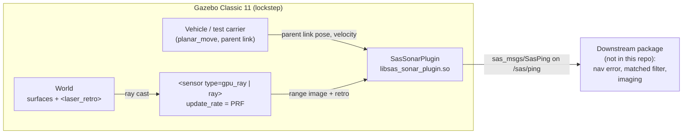
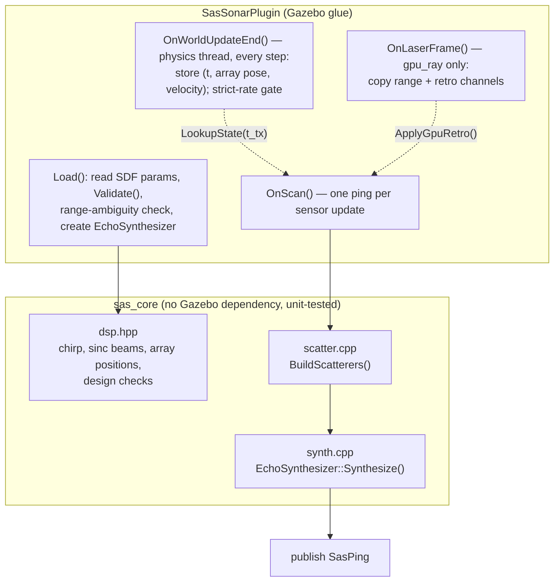
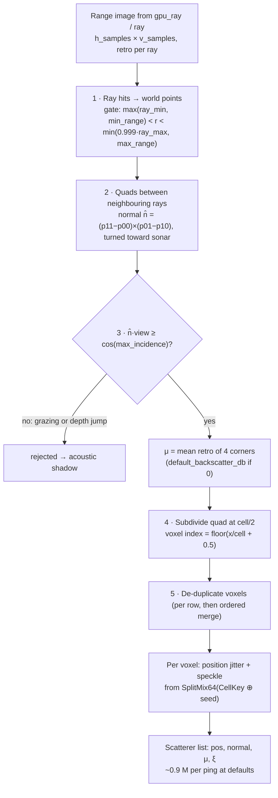
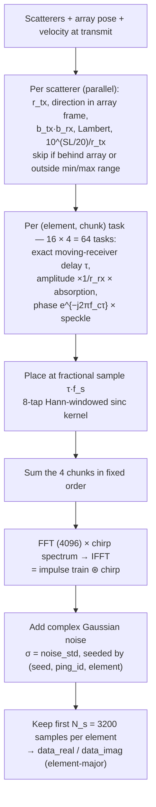

# SAS Sensor Implementation Study

How the SAS sensor plugin in this repository works, what kind of sensor it models, and how every
parameter — including the Xacro parameters — enters the computation. Everything here is taken
from the implementation at release `v0.1.0`:

| Source | What it defines |
|--------|-----------------|
| `src/sas_description/urdf/sas_array.xacro` | Mount, ray fan, all plugin parameters |
| `src/sas_description/urdf/sas_test_carrier.urdf.xacro` | Test vehicle and array mount pose |
| `src/sas_gazebo/src/sas_sonar_plugin.cpp` | Gazebo glue: scan, state, timing, publishing |
| `src/sas_gazebo/include/sas_gazebo/dsp.hpp` | Chirp, beams, array positions, checks, defaults |
| `src/sas_gazebo/include/sas_gazebo/scatter.hpp`, `src/scatter.cpp` | Scene → scatterer field |
| `src/sas_gazebo/include/sas_gazebo/synth.hpp`, `src/synth.cpp` | Propagation and echo synthesis |
| `src/sas_msgs/msg/SasPing.msg` | Output contract |

Companion document: `SAS_Parameter_Tuning_Guide.md` (what to change, and what happens when you do).

---

## 1. What kind of SAS sensor this is

**A side-looking, strip-map, multi-receiver (single-transmitter, 16-receiver) synthetic aperture
sonar, simulated at the raw-data level in complex baseband.**

| Property | Implementation | Where |
|----------|----------------|-------|
| Geometry | Side-looking, strip-map: fixed boresight to starboard, 20° below horizontal | `sas_test_carrier.urdf.xacro` mount `rpy="0 0.35 -1.5708"` |
| Array | 1 transmitter + N = 16 receivers in a line along-track (SIMO, "multi-aperture") | `num_elements`, `element_spacing` |
| Frequency class | High-frequency: 100 kHz carrier, 20 kHz bandwidth (20 % fractional) | `center_frequency`, `bandwidth` |
| Waveform | Linear frequency-modulated (LFM) chirp, 5 ms, up-sweep | `pulse_length`, `dsp::ChirpSamples` |
| Output | Raw, **not** range-compressed, complex baseband echo per element | `SasPing.data_real/imag`, ADR-0002 |
| Scene model | World-fixed voxel point scatterers built from Gazebo ray casting, with Lambertian backscatter and complex Gaussian speckle | `scatter.cpp` |
| Propagation | Two-way spherical spreading, Thorp absorption, sinc beam patterns, receiver motion during propagation (no stop-and-hop) | `synth.cpp` |
| Ground truth | Exact array pose and velocity at transmit time; no navigation error | `SasPing.pose/velocity`, ADR-0003 |

What it is **not**: the plugin does not form images, apply matched filtering, model navigation
error, or move the vehicle. Those belong to the downstream package (ADR-0001). The sensor plays
the role of the physical hardware: it transmits, listens, and reports exactly what it heard and
where it was.

---

## 2. Architecture

### 2.1 Packages and runtime context



| Package | Role |
|---------|------|
| `sas_msgs` | `SasPing` message (frozen contract, ADR-0003) |
| `sas_gazebo` | `sas_core` (Gazebo-free physics library) + `libsas_sonar_plugin.so` |
| `sas_description` | `sas_array.xacro` macro, `sas_test_carrier.urdf.xacro` |
| `sas_bringup` | Test worlds, `sas_sensor.launch.py` |

### 2.2 Inside the plugin



Threads: physics runs `OnWorldUpdateEnd`; the sensor (CPU `ray`) or rendering (`gpu_ray`) thread
runs `OnLaserFrame` and `OnScan`. Scatterer building and synthesis use OpenMP across all cores.

---

## 3. Coordinate frames and array geometry

### 3.1 Array frame

The array frame (`sas_array_link`) is: **x = boresight, y = along-track, z = up (array-relative)**.

```
                 array z (up)
                   ▲
                   │
                   │      ● ● ● ● ● ● ● ● ● ● ● ● ● ● ● ●     16 receivers on the y-axis
                   │      ────────────────▲────────────────
                   └──────────────────────┼──────────────────────►  array y (along-track)
                  /                       T  transmitter at the origin
                 /
                ▼  array x (boresight, toward the seabed / targets)
```

Receiver positions (`dsp::ReceiverPositionsY`):

$$y_k = \left(k - \tfrac{N-1}{2}\right) d, \qquad k = 0 \ldots N-1, \qquad x_k = z_k = 0$$

With N = 16 and d = 0.04 m: y₀ = −0.30 m … y₁₅ = +0.30 m, centred on the transmitter at the
origin. Physical array length N·d = 0.64 m (also the size of the visual box in the Xacro).

```
 y [m]: -0.30 -0.26 -0.22 -0.18 -0.14 -0.10 -0.06 -0.02 +0.02 +0.06 +0.10 +0.14 +0.18 +0.22 +0.26 +0.30
          R0    R1    R2    R3    R4    R5    R6    R7  T  R8    R9   R10   R11   R12   R13   R14   R15
          |<-- d = 0.04 m -->|                         (T at y = 0)
```

### 3.2 Phase centres (why spacing matters)

For a transmitter at 0 and receiver at yₖ, the two-way path behaves like a single co-located
transmitter/receiver at the midpoint yₖ/2 (the "phase centre"). Phase centres are therefore spaced
**d/2 = 0.02 m** apart and span **N·d/2 = 0.32 m**. This is what the DPCA sampling rule (§7.3)
and the validation test V4 rely on.

### 3.3 Mount on the vehicle

`sas_test_carrier.urdf.xacro` mounts the array with
`xyz="0.0 -0.17 0.0" rpy="0 0.35 -1.5708"`:

- `yaw = −π/2` turns array x to the vehicle's starboard (−y) and array y to the vehicle's forward (+x):
  **along-track = direction of travel**.
- `pitch = 0.35 rad` (20°) tilts the boresight down.
- `y = −0.17 m` places the array on the starboard hull side.

```
   Side view (looking forward, vehicle moving into the page)

        vehicle ▣───● array (0.17 m starboard)
                      ╲  20° boresight depression
                       ╲          ray fan: −0.80 … +0.20 rad about boresight
                        ╲         = 8.6° … 65.9° below horizontal
        ──────────────────────────────────────────────── seabed
         nearest echo ≈ 10.9 m slant      far edge gated at 60 m slant
         (4.5 m ground range at 10 m altitude)
```

---

## 4. Signal model and equations

### 4.1 Transmit pulse (REQ-001)

Complex baseband LFM chirp, generated once in `dsp::ChirpSamples`:

$$p(t) = \exp\!\left(j\pi K\left(t - \tfrac{T_p}{2}\right)^2\right), \quad 0 \le t < T_p, \quad K = \frac{B}{T_p}$$

Instantaneous frequency f(t) = K(t − Tₚ/2) sweeps −B/2 → +B/2 = −10 kHz → +10 kHz around the
carrier. Samples: Nₚ = ⌈Tₚ·fₛ⌉ = 200.

### 4.2 Received signal

For element k, summed over all scatterers i:

$$s_k(t) = \sum_i a_{ik}\; p(t - \tau_{ik})\; e^{-j 2\pi f_c \tau_{ik}} + n_k(t)$$

### 4.3 Two-way delay with receiver motion (REQ-008)

The receiver keeps moving at velocity **v** while the echo travels. With D = P − Rₖ (scatterer
minus receiver position at transmit) and r_tx = |P − T|:

$$\tau = \frac{r_{tx} + \rho}{c}, \qquad \rho = \left|\mathbf{D} - \mathbf{v}\,\tau\right|$$

Substituting τ gives a quadratic in ρ that the code solves exactly (`synth::SolveDelayFromTx`):

$$(1-\beta^2)\rho^2 + 2(g - \beta^2 r_{tx})\,\rho + (2 g\, r_{tx} - \beta^2 r_{tx}^2 - |\mathbf{D}|^2) = 0,
\qquad g = \frac{\mathbf{D}\cdot\mathbf{v}}{c},\; \beta^2 = \frac{|\mathbf{v}|^2}{c^2}$$

(The reference document's one-step iteration was off by 38 µm at 3 m/s; this closed form is exact.)

### 4.4 Amplitude (REQ-003, REQ-006, REQ-007)

$$a_{ik} = 10^{SL/20}\;\frac{\sqrt{\mu_i \cos^2\theta_i\, A_{cell}}}{R_{tx}\,R_{rx}}\; b_{tx}\, b_{rx}\; 10^{-\alpha (R_{tx}+R_{rx})/20}\;\xi_i$$

| Term | Meaning | Implementation |
|------|---------|----------------|
| 10^(SL/20) | Source level as amplitude scale | `source_level` |
| μᵢ | Lambert backscatter coefficient (linear power) | `<laser_retro>` of the surface, else `default_backscatter_db` |
| cos θᵢ | Incidence: −n̂·d̂, normal faces the sonar | quad normal from the ray image |
| A_cell | Area per scatterer | `cell_size²` = 0.0016 m² |
| 1/(R_tx R_rx) | Two-way spherical spreading (amplitude) | exact ranges |
| b_tx, b_rx | Aperture beam patterns (§4.5) | `tx_length/height`, `element_length/height` |
| α | Absorption, dB/m | Thorp at f_c (§4.6) or `absorption_db_per_m` |
| ξᵢ | Unit-variance complex Gaussian speckle, fixed per voxel | hash of voxel index (§5.3) |

### 4.5 Beam patterns and wavelength

Wavelength is **derived**, not a parameter:

$$\lambda = \frac{c}{f_c} = \frac{1500}{100\,000} = 0.015\ \text{m}$$

Each aperture of length D is a uniform line source with pattern

$$b(\theta) = \operatorname{sinc}\!\left(\frac{D \sin\theta}{\lambda}\right), \qquad \operatorname{sinc}(x) = \frac{\sin \pi x}{\pi x}$$

applied separately along-track (direction component u_y in the array frame) and vertically (u_z):

$$b_{tx} = \operatorname{sinc}\!\left(\tfrac{L_{tx} u_y}{\lambda}\right)\operatorname{sinc}\!\left(\tfrac{H_{tx} u_z}{\lambda}\right), \qquad
b_{rx} = \operatorname{sinc}\!\left(\tfrac{L_{el} u_y}{\lambda}\right)\operatorname{sinc}\!\left(\tfrac{H_{el} u_z}{\lambda}\right)$$

```
 Along-track two-way pattern b_tx·b_rx = sinc²(0.04·sinθ / 0.015)   (L_tx = L_el = 0.04 m = 2.67 λ)
 (schematic shape; the numbers on the right are exact)

   0 dB ┤          ▁▄▆██▆▄▁
        │       ▂▅█████████▅▂          −3 dB two-way at ±6.9°
  −10   ┤     ▃███████████████▃        −3 dB one-way at ±9.5°
        │   ▂██████████████████▂
  −20   ┤  ▄████████████████████▄
        │ ██████████████████████ █     first null at sinθ = λ/D = 0.375 → ±22.0°
        └─┴─────┴─────┴─────┴─────┴─►  θ (deg)
         −22   −11    0    11    22
```

Vertically, H = 0.015 m = 1 λ puts the first null at sinθ = 1 (90°): the elevation beam is
nearly omnidirectional, so the seabed is lit across the whole vertical fan.

The ray fan's horizontal half-width (0.40 rad = 22.9°) is chosen to just exceed the beam's
first null (22.0°): every direction with non-zero beam response is ray-cast, and no rays are
wasted far outside it.

### 4.6 Absorption (Thorp)

$$\alpha_{\text{dB/km}} = \frac{0.11 f^2}{1 + f^2} + \frac{44 f^2}{4100 + f^2} + 2.75\times10^{-4} f^2 + 0.003, \quad f \text{ in kHz}$$

At 100 kHz: 34.07 dB/km = **0.0341 dB/m**, i.e. 4.1 dB extra two-way loss at 60 m.

### 4.7 Derived performance figures (defaults)

| Quantity | Equation | Value |
|----------|----------|-------|
| Wavelength | λ = c/f_c | 1.5 cm |
| Range resolution | δr = c/(2B) | 3.75 cm |
| Theoretical along-track resolution | δx = D/2 | 2 cm |
| Synthetic aperture length | L_sa = λR/D | 0.375·R → 15 m at 40 m |
| Time-bandwidth product | B·Tₚ | 100 (20 dB compression gain downstream) |
| Samples per ping | N_s = ⌈2R_max f_s / c⌉ | 3200 |
| FFT size | next power of 2 ≥ N_s + Nₚ + 8 | 4096 |
| Unambiguous range | c·PRI/2 | 75 m at 10 Hz (≥ 60 m max range) |
| DPCA speed limit | v ≤ N d /(2·PRI) | 3.2 m/s at 10 Hz |

---

## 5. Scene reconstruction: from rays to scatterers

### 5.1 Pipeline (`scatter::BuildScatterers`)



### 5.2 Shadows

A quad whose surface is almost parallel to the ray (n̂·v̂ < cos 88° = 0.035) is rejected. Two cases
produce such quads: grazing surfaces, and the "bridge" between a near object and the ground behind
it. Rejecting the bridge leaves the hidden ground empty — an acoustic shadow.

```
   sonar ●
          ╲  ╲
           ╲   ╲            the quad bridging the box top and the ground behind it
            ╲    ╲          is nearly parallel to the rays → rejected → shadow
             ┌──┐  ╲
             │  │    ╲
   ──────────┴──┴░░░░░░───────  seabed  (░ = shadow: no scatterers)
```

The bridge is only rejected if the rays are dense enough:
R·Δθ/ΔR < cos(max_incidence). With 512 rays, Δθ ≈ 0.0016 rad (horizontal) and 0.0020 rad
(vertical); with 64 rays (0.016 rad) the bridge at 15 m survives and the shadow fills in
(measured in plan 004).

### 5.3 World-fixed, coherent scatterers (REQ-005, ADR-0004)

SAS focusing needs every scatterer to keep the same position and complex reflectivity in every
ping. Ray hits move with the vehicle, so they cannot be scatterers. Instead each hit is snapped to
a world voxel, and the voxel's properties are a pure function of its integer index:

```
 voxel (ix, iy, iz) ──► key = CellKey(ix, iy, iz)   (21 bits per axis, ±2²⁰ cells = ±41.9 km at 4 cm)
                    ──► h₀…h₄ = SplitMix64 chain of (key ⊕ seed)
 position = ((ix, iy, iz) + 0.8·(U(h₀,h₁,h₂) − 0.5)) · cell     jitter within ±0.4 cell
 speckle  = sqrt(−ln U(h₃)) · e^{j 2π U(h₄)}                   |ξ|² ~ Exp(1), uniform phase
```

Voxels are **centred on multiples of `cell_size`** (`floor(x/cell + 0.5)`). With plain
`floor(x/cell)`, a seabed at z = 0 sits on a voxel boundary, float noise splits it into two
flickering layers, and coherence breaks (found and fixed in plan 004).

Measured result (V4, DPCA test): echoes of overlapping phase centres in consecutive pings
correlate at **0.9995**.

### 5.4 Per-surface reflectivity (`<laser_retro>`)

| Surface (test worlds) | `laser_retro` = μ | dB |
|-----------------------|-------------------|----|
| Sand seabed | 0.002 | −27 |
| Rock | 0.02 | −17 |
| Metal target | 0.3 | −5 |
| Plate / point target | 1.0 | 0 |
| `laser_retro` = 0 | `default_backscatter_db` | −27 |

`gpu_ray` reads `<laser_retro>` from **visual** elements, CPU `ray` from **collision** elements; the
worlds set both. In Gazebo 11, `GpuRaySensor::Retro()` always returns 0, so the plugin reads the
retro channel from the raw GPU laser frame instead (BUG-001, ADR-0011).

---

## 6. Echo synthesis (`EchoSynthesizer::Synthesize`)

### 6.1 Steps



### 6.2 Fractional delay

Each echo is placed at the non-integer sample n_f = τ·f_s with 8 taps
m = n₀−3 … n₀+4, n₀ = ⌊n_f⌋:

$$w_m = \operatorname{sinc}(n_f - m)\cdot \tfrac12\left(1 + \cos\frac{\pi (n_f - m)}{4}\right)$$

This is band-limited (no nearest-sample error). The implementation evaluates all 8 taps from 3 trig
calls using sin(π(f+k)) = (−1)ᵏ sin(πf) and angle addition (plan 009); a unit test checks it
against the direct formula.

### 6.3 Why convolve in the frequency domain

Building one impulse per scatterer and convolving once with the chirp (FFT multiply) costs one
4096-point FFT pair per element, instead of writing 200 chirp samples for each of ~0.9 M
scatterers. The chirp spectrum is computed once at load time.

### 6.4 Determinism (REQ-012)

| Source of non-determinism | How it is removed |
|---------------------------|-------------------|
| Random speckle | Hash of voxel index, no stateful RNG |
| Thread scheduling | Fixed partitions (row candidates merged in order; 4 fixed chunks per element summed in order) |
| FFTW plan choice | `FFTW_ESTIMATE` (not `MEASURE`, which picks algorithms by timing) |
| Noise | `mt19937_64` seeded per (seed, ping_id, element) |
| Physics/sensor timing | Strict-rate gate (CPU `ray`) or `--lockstep` (`gpu_ray`); state from per-step history |

Result: two runs with the same world, seed, and parameters produce bit-identical echoes (V6), and
1 vs 8 threads produce bit-identical scatterers and echoes (unit tests).

---

## 7. Timing, state, and design checks

### 7.1 One ping per sensor update

`update_rate` = PRF (Xacro `prf`, default 10 Hz). Each update runs the whole pipeline once. The
ping's time stamp is the sensor's measurement time.

### 7.2 Exact transmit-time state (REQ-011, ADR-0010)

Physics keeps stepping while a ping is computed, so the link cannot be read inside the callback.
Instead, after every physics step (1 ms), the plugin stores (t, array pose, velocity) in a
ring buffer of 8192 samples, and each ping looks up the entry at its measurement time.

```
 physics thread:  step ─► store(t, pose, v) ─► [gate: wait if t ≥ last_ping + PRI and
                                                 that ping is not published yet]   (CPU ray only)
 sensor thread:   scan at t_tx ─► LookupState(t_tx) ─► scatterers ─► synthesis ─► publish
```

- CPU `ray`: Gazebo's `--lockstep` does not wait for this sensor's callback, so the plugin gates
  physics itself (`strict_rate`, default on for `ray`).
- `gpu_ray`: `--lockstep` holds the rate; the gate is forced off (it would deadlock).

Measured: stamps exactly 0.100 s apart; pose advance = v·Δt within 6·10⁻¹⁵ m.

### 7.3 Design checks (REQ-013, warnings only)

| Check | Condition for warning | Default margin |
|-------|-----------------------|----------------|
| Range ambiguity (at load) | 2·max_range/c > PRI | 0.080 s < 0.100 s |
| DPCA along-track sampling (each ping) | \|v_along\|·PRI > N·d/2 | warns above 3.2 m/s |
| Ping interval (each ping) | \|Δt − PRI\| > 1 % PRI | — |

---

## 8. Xacro parameters: how each one is used

### 8.1 `sas_array` macro arguments

| Xacro arg | Default | Becomes | Used in | Effect on the result |
|-----------|---------|---------|---------|----------------------|
| `parent` | (required) | joint parent link | URDF | Link whose motion the sensor reports |
| `xyz` | (required) | joint origin | URDF → `sensor_->Pose()` | Array position on the vehicle |
| `rpy` | (required) | joint orientation | URDF → `sensor_->Pose()` | Boresight direction; along-track axis |
| `prefix` | `''` | link, joint, sensor, plugin names | URDF/SDF | Allows several arrays on one vehicle |
| `sensor_type` | `gpu_ray` | `<sensor type>` | plugin `Load()` | GPU (fast, needs display + `--lockstep`) or CPU ray casting |
| `prf` | `10.0` | `<update_rate>` | PRI = 1/prf | Ping rate; range ambiguity; DPCA speed limit |
| `h_samples` | `512` | horizontal ray count | `scatter` | Ray density along-track: shadow quality, cost |
| `v_samples` | `512` | vertical ray count | `scatter` | Ray density in elevation: shadow quality, cost |
| `num_elements` | `16` | `<num_elements>` | `dsp`, `synth` | N receivers: array length, DPCA limit, synthesis cost |
| `element_spacing` | `0.04` | `<element_spacing>` | `dsp::ReceiverPositionsY` | d: receiver positions, phase-centre spacing d/2 |
| `topic` | `/sas/ping` | `<topic>` | publisher | Output topic |
| `seed` | `12345` | `<seed>` | speckle hash, noise seed | Which speckle/noise realisation |
| `cell_size` | `0.04` | `<cell_size>` | `scatter`, `synth` (A_cell) | Scatterer density, speckle grain, cost |
| `noise_std` | `1e-7` | `<noise_std>` | `synth` | Receiver noise per I/Q component |
| `debug` | `false` | `<debug_scatterers>` | plugin logs | Per-ping scatterer, retro, timing summary |

### 8.2 Fixed values inside the macro (edit the Xacro to change them)

| SDF element | Value | Used in |
|-------------|-------|---------|
| ray `horizontal min/max_angle` | −0.40 / +0.40 rad | ray fan along-track; covers beam null at ±0.384 rad |
| ray `vertical min/max_angle` | −0.80 / +0.20 rad | ray fan in elevation (8.6°–65.9° depression after 20° pitch) |
| ray `range min/max/resolution` | 1.0 / 70.0 / 0.001 m | ray limits; plugin gates at `min_range`/`max_range` |
| `sound_speed` | 1500.0 m/s | λ, delays, N_s |
| `center_frequency` | 100000.0 Hz | λ, carrier phase, Thorp α |
| `bandwidth` | 20000.0 Hz | chirp sweep, δr |
| `pulse_length` | 0.005 s | chirp duration, Nₚ |
| `sample_rate` | 40000.0 Hz | complex sampling, N_s, fractional delay |
| `min_range` / `max_range` | 2.0 / 60.0 m | scatterer gate, N_s |
| `element_length` | 0.04 m | receive beam along-track |
| `element_height` | 0.015 m | receive beam vertical |
| `tx_length` | 0.04 m | transmit beam along-track |
| `tx_height` | 0.015 m | transmit beam vertical |
| `max_incidence_deg` | 88.0 | shadow / grazing rejection |
| `default_backscatter_db` | −27.0 | μ when `laser_retro` = 0 |
| `source_level` | 0.0 dB | amplitude scale |
| `absorption_db_per_m` | commented out → Thorp(f_c) | α |
| `strict_rate` | commented out → on for `ray`, off for `gpu_ray` | timing gate |

There is **no wavelength parameter**: λ = `sound_speed` / `center_frequency`. Changing either one
changes λ and with it the beam widths (sinc argument D·sinθ/λ), the carrier phase rate, and the
along-track sampling rule.

### 8.3 Test-carrier and launch parameters

| Parameter | Default | Effect |
|-----------|---------|--------|
| carrier mount `xyz` | `0.0 -0.17 0.0` | starboard array |
| carrier mount `rpy` | `0 0.35 -1.5708` | 20° depression; along-track = forward |
| launch `speed` | 1.5 m/s | `cmd_vel` linear.x for `planar_move` |
| launch `x y z yaw` | −10, 0, 10, 0 | spawn pose (10 m altitude) |
| launch `world` | `sas_seabed.world` | scene |
| launch `sensor_type`, `prf`, `h_samples`, `v_samples`, `debug` | as above | passed to the carrier Xacro |

---

## 9. Output: `SasPing`

| Field group | Fields | Units |
|-------------|--------|-------|
| Header | `stamp` (transmit sim time), `frame_id`, `ping_id` | — |
| Waveform | `sound_speed`, `center_frequency`, `bandwidth`, `pulse_length`, `sample_rate`, `t0` = 0, `source_level`, `noise_std` | m/s, Hz, Hz, s, Hz, s, dB, — |
| Geometry | `tx_position`, `rx_positions[]` (array frame), `element_length`, `tx_length` | m |
| State | `pose` (array frame in world), `velocity` (world) — ground truth | m, m/s |
| Echo | `num_elements`, `num_samples`, `data_real[]`, `data_imag[]`, index = k·num_samples + n | float32 |

Sample n corresponds to two-way delay n/f_s after transmit (t0 = 0), i.e. slant range n·c/(2f_s) =
n·1.875 cm. A downstream matched filter needs only the message fields (validated: the V1–V7 test
models are rebuilt from message fields alone).

---

## 10. How the pieces achieve the result

| Goal | Mechanism | Evidence |
|------|-----------|----------|
| Correct delays per element | exact geometry + moving-receiver delay + band-limited fractional delay | V1 (±1.3 samples, speckle-limited), unit test 0.1 sample, V5 |
| Correct amplitudes | spreading, Thorp, Lambert, sinc beams | V2 (≤ 0.73 dB), V3 (≤ 0.63 dB) |
| Coherence for SAS focusing | world-fixed voxels, hashed speckle, centred voxel grid | V4 DPCA correlation 0.9995 |
| Realistic scenes | ray casting, shadow rejection, per-surface μ | unit tests; plate/box worlds |
| Exact ground truth | per-step state history at measurement time | plan 006: 6·10⁻¹⁵ m |
| Reproducibility | hashing, fixed partitions, seeded noise, `FFTW_ESTIMATE` | V6 bit-identical |
| Speed | parallel build + chunked synthesis | 187 ms per ping, RTF 0.53 (REQ-103) |

---

## 11. Known limits

- Constant sound speed; no refraction, multipath, or surface bounce.
- Geometry comes from rendered (gpu) or collision (cpu) shapes; invisible objects give no echo.
- Lambert scattering only; no specular highlights or resonances.
- Beam patterns at the centre frequency only.
- Surfaces are quantised to `cell_size`; small objects (< a few cells) are speckle-dominated, and
  objects smaller than the ray spacing may be missed entirely.
- No intra-pulse Doppler (acceptable below ~3 m/s).
- Transmitter fixed at the array origin (`tx_offset_along_track` from the reference design is not
  implemented); `tx_position` is always (0, 0, 0).
- `element_height`, `tx_height`, and the absorption value are not in `SasPing` (they affect
  amplitude only).
